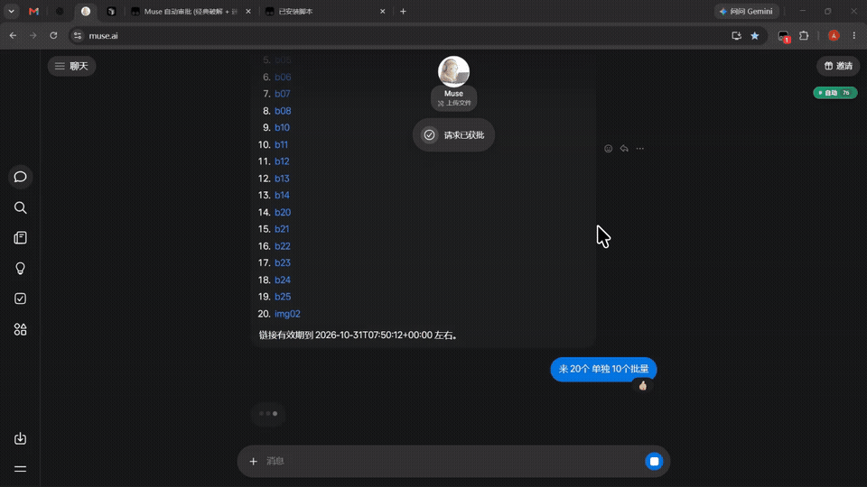
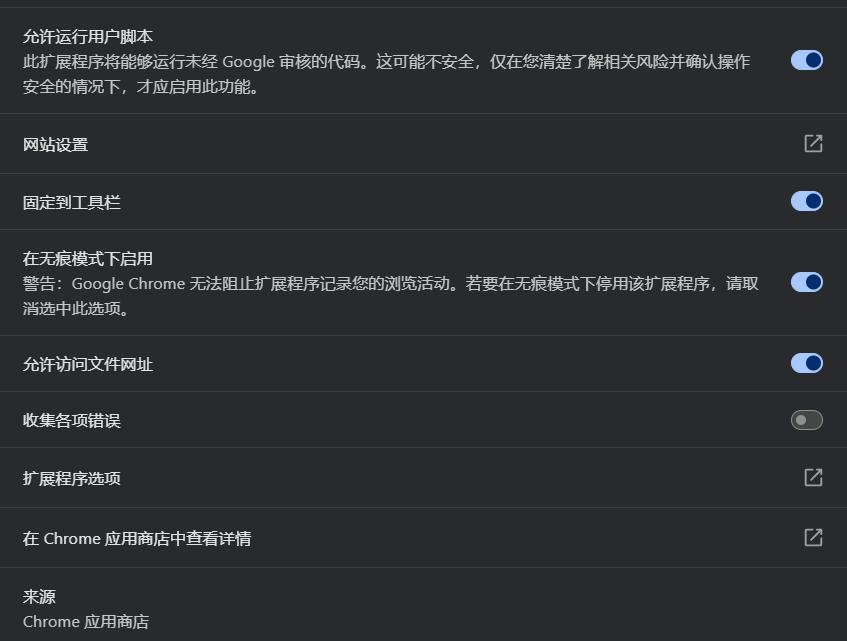
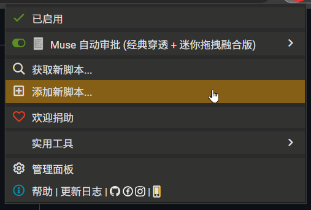

# Muse 自动审批助手 (Muse Auto Approve)

<p align="center">
  
</p>

<p align="center">
  <b>简体中文</b> · <a href="README_en.md">English</a>
</p>

<p align="center">
  <b>专为 <a href="https://muse.ai">Muse.ai</a> 打造的自动化权限审批工具</b><br>
  双模支持：Chrome 原生扩展 (Manifest V3) + 油猴用户脚本 (Tampermonkey)<br>
  RPC 静默直通 · 穿透封闭组件与 iframe · 审批上下文防误点 · 验成败真实计数 · 迷你拖拽记忆胶囊
</p>

<p align="center">
  
  
  
  
</p>

---

## 动态演示 (Demo)

自动侦测 Muse 上传文件、执行操作等权限确认对话框，毫秒级响应并自动完成批准：



---

## 核心特性

- **协议优先双引擎（RPC 第一引擎为主 + DOM 穿透第二引擎兜底）**  
  启动后优先通过 React Fiber（支持 React 18 双缓冲树 `stateNode.current`）提取 `HatchRpc` 通道，主动持续查询 `egress.approvals` 并批单，不依赖页面出卡；仅当协议线连不上或查不到时，DOM 穿透第二引擎才无缝接管兜底。协议失败会显式写明原因（连不上 / 没权限 / 接口报错原文）并拉长间隔自动重试，绝不静默装死。

- **严格档位优先（全部 / 永久允许优先，降级兜底单个允许）**  
  RPC 侧默认先发 `allow_always`（永久允许），遇到服务端限制仅允许单次的项目自动降级为 `allow_once`；页面点击侧支持五级档位排序（`全部允许 / 全部永久允许` > `永久允许 / 始终允许 / 始终允许此网站 / 始终允许此连接器 / Always allow this site` > `全部允许一次` > `此网站内允许 / 此任务内允许 / Allow for this site / Allow for this task` > `允许 / Allow / Approve`），自动剥离按钮角标数字（如 `全部允许 (3)`）。

- **审批上下文强校验（根治误点）**  
  不再盲点全页任意“允许 / Allow / Approve”按钮；仅对包含配对拒绝/取消按钮或明确审批提示语的确认卡片动手，自动跳过导航栏、代码块、设置开关及禁用按钮。

- **验成败真实计数与破冰重试**  
  RPC 必须拿到服务端成功确认才计次；页面点击采用延迟验收（确认按钮消失、禁用或状态变更才 `+1`），点击未生效时不虚增计数，下一轮自动升级为 React `onClick` 直击破冰。

- **Closed Shadow DOM 穿透与零内存泄漏**  
  在 `document-start` 极早生命周期重写 `Element.prototype.attachShadow`，配合 `WeakRef` 自动回收已卸载的 ShadowRoot，并结合 `MutationObserver` 事件驱动扫描大幅降低 CPU 占用。

- **多实例互斥与严格域名隔离**  
  跨实例共享状态与代际号防止重复注入重批；主机名严格限定为 `muse.ai` 及 `*.muse.ai`，绝不干扰第三方站点；自动迁移旧版 v6.3/v6.4 的开关状态、计数与悬浮胶囊位置。

- **极简可拖拽悬浮胶囊**  
  - **按住拖动**：自由放置在屏幕任意位置，自动持久化记忆坐标，页面刷新不丢失。
  - **左键单击**：一键切换“自动运行 / 暂停”状态，并同步子 iframe。
  - **右键单击**：一键清零审批累计计数。
  - **原版极简外观**：收起态保持迷你胶囊（仅显示小圆点、`自动/暂停` 与累计数字，小圆点轻柔指示协议状态），平时安静不弹窗；鼠标悬停展开详情面板查看协议状态、最近批单时间与明细；仅在协议或兜底出错时短暂弹出错误提示并自动消失。

---

## 安装与使用

本项目同时支持 Chrome / Edge 扩展与 Tampermonkey 油猴脚本两种运行方式，任选其一即可。

### 方式一：油猴脚本安装（推荐，简单快速）

1. 确保浏览器已安装脚本管理器扩展：
   - [Tampermonkey (篡改猴)](https://www.tampermonkey.net/)
   - [Violentmonkey (暴力猴)](https://violentmonkey.github.io/)
   - [ScriptCat (脚本猫)](https://docs.scriptcat.org/)

2. **前置权限（针对 Chrome / Edge 最新版）**：  
   在基于 Chromium 的新版浏览器（Chrome 126+ 等）中，受安全策略限制，必须手动允许油猴运行用户脚本，否则脚本将无法注入页面：
   - 打开浏览器地址栏输入 `chrome://extensions/` 进入扩展管理页。
   - 找到已安装的 Tampermonkey（篡改猴），点击进入**“详细信息”**。
   - 找到并开启 **「允许运行用户脚本」** 开关（如下图所示；若未找到该选项，请先在扩展管理页右上角开启“开发者模式”）。

   <p align="center">
     
   </p>

3. **添加并安装脚本（两种途径任选）**：

   - **途径 A：手动添加脚本（最稳妥，推荐）**
     1. 打开本仓库的 [`muse-auto-approve.user.js`](./muse-auto-approve.user.js) 文件，完整复制全部源码。
     2. 点击浏览器右上角工具栏的 Tampermonkey 图标，在弹出菜单中点击 **「添加新脚本...」**（如下图所示）。
     3. 清空编辑器中的原有模板内容，粘贴刚才复制的代码。
     4. 按快捷键 `Ctrl + S`（Mac 为 `Cmd + S`）或点击左上角“文件 -> 保存”即可完成安装。

     <p align="center">
       
     </p>

   - **途径 B：在线一键安装**
     - 打开本仓库的 [`muse-auto-approve.user.js`](./muse-auto-approve.user.js) 页面，点击右上角的 **Raw** 按钮，Tampermonkey 将自动弹出安装界面，点击“安装”即可。

4. 打开 [muse.ai](https://muse.ai)，页面右上角即可看到控制胶囊。

### 方式二：Chrome 扩展安装（开发者模式）

1. 前往 [Releases 发布页](https://github.com/waw666waw666/MuseAutoApprove/releases) 直接下载打包好的 `MuseAutoApprove-v6.4.zip` 并解压（或直接下载/克隆本仓库）。
2. 在 Chromium 浏览器（Chrome、Edge、Brave、Arc 等）地址栏输入：
   ```text
   chrome://extensions/
   ```
3. 在右上角开启“开发者模式 (Developer mode)”。
4. 点击左上角“加载已解压的扩展程序 (Load unpacked)”。
5. 选择解压后的文件夹即可完成加载。

---

## 悬浮胶囊操作指南

| 操作 | 响应动作 | 视觉反馈 |
| :--- | :--- | :--- |
| **鼠标左键单击** | 切换运行状态（开启 / 暂停） | 绿色高亮（自动） / 灰色暗淡（暂停） |
| **鼠标按住拖拽** | 移动胶囊至屏幕任意位置 | 放开后自动保存当前屏幕像素坐标 |
| **鼠标右键单击** | 清空当前累计审批次数 | 计数徽章归零 `0` |

---

## 项目结构

```text
MuseAutoApprove/
├── manifest.json                  # Chrome 扩展配置文件 (Manifest V3)
├── content.js                     # 扩展端 Content Script
├── muse-auto-approve.user.js      # 油猴/用户脚本端源码 (带规范元数据头)
├── tests/
│   └── auto-approve.test.mjs      # 7 组自动化沙箱单元测试 (node tests/auto-approve.test.mjs)
├── icons/                         # 扩展图标 (16x16, 48x48, 128x128)
├── assets/                        # 演示动图与截图素材
│   ├── demo.gif                   # 演示动图
│   ├── preview.png                # 高清截图
│   ├── tampermonkey-permission.png# 允许运行用户脚本权限配置示例图
│   └── tampermonkey-add-script.png# 油猴菜单点击“添加新脚本...”示例图
├── LICENSE                        # MIT 开源协议
├── README.md                      # 项目详细文档 (简体中文)
└── README_en.md                   # 英文说明文档 (English)
```

---

## 免责声明 (Disclaimer)

1. **用途限制**：本工具仅供技术研究、学习交流及个人合法工作流自动化提效使用，严禁用于任何破坏平台正当运营或违规行为。使用者应严格遵守目标平台（包括但不限于 Muse.ai）的服务条款（Terms of Service）与用户协议。
2. **账号与安全风险**：本工具通过模拟前端事件流执行自动化审批。因自动化操作引发的任何后果，包括但不限于**账号被封禁（封号）、权限冻结、功能降级、访问受限、接口限流或风控拦截**等，均由使用者自行承担全部责任。
3. **数据与资产变动**：自动化审批将在无人工干预的情况下极速放行操作请求（如文件上传、公开链接生成等）。作者不对因使用本扩展/脚本造成的任何意外误操作、数据变动、隐私泄露或潜在财产损失承担任何法律责任。
4. **软件现状提供**：本项目按“现状 (AS IS)”提供，不提供任何明示或暗示的担保。下载、安装或使用即代表您已充分阅读、知悉并完全同意本免责声明的全部条款。

---

## 开源许可

本项目遵循 [MIT License](./LICENSE) 开源协议。
