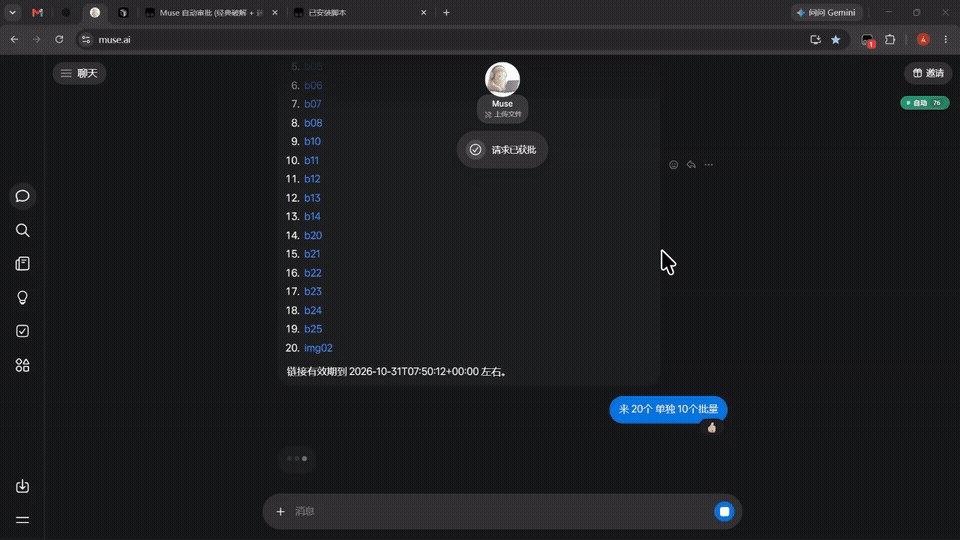
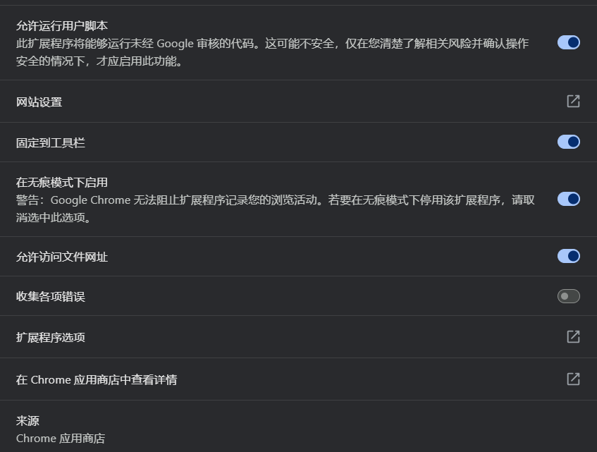
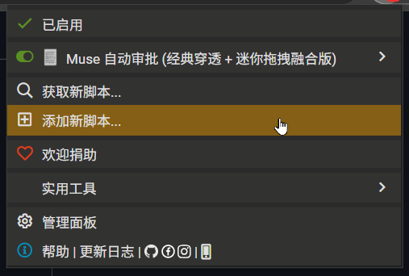

# Muse Auto Approve

<p align="center">
  
</p>

<p align="center">
  <a href="README.md">简体中文</a> · <b>English</b>
</p>

<p align="center">
  <b>Automated permission approval tool designed specifically for <a href="https://muse.ai">Muse.ai</a></b><br>
  Dual-mode support: Native Chrome Extension (Manifest V3) + Tampermonkey Userscript<br>
  Closed Shadow DOM bypass · Deep iframe sandbox traversal · Synthetic event dispatch · Draggable floating badge
</p>

<p align="center">
  
  
  
  
</p>

---

## Demo

Automatically detects permission dialogs on Muse (file uploads, tool executions, etc.) and approves them within milliseconds:



---

## Key Features

- **Closed Shadow DOM Penetration**  
  Hooks `Element.prototype.attachShadow` at the `document-start` lifecycle stage, downgrading closed shadow roots to `open` mode to penetrate modern Web Component encapsulations.

- **Deep Iframe Sandbox Traversal & Cross-Window Broadcasting**  
  Recursively traverses the main document and all same-origin nested iframes. Approval actions triggered inside child frames are safely broadcast to the top window via `postMessage` for unified count synchronization.

- **Synthetic Event Chain & Direct React Handler Execution**  
  Dispatches a full event sequence (`pointerdown` -> `mousedown` -> `pointerup` -> `mouseup` -> `click`) and directly invokes React internal `onClick` handlers via `__reactProps$` / `__reactEventHandlers$` to prevent ghost clicks or missed triggers.

- **Intelligent Batch-First Decision Strategy**  
  Prioritizes batch approval buttons (`Allow all once`, `Allow all`, `Always allow`, `全部允许一次`, `全部允许`) over single-action buttons (`Allow`, `Approve`, `允许`), maximizing multi-task throughput.

- **Dual Debounce & WeakMap Cooldown Lock**  
  Implements a per-element 1500ms cooldown via `WeakMap` alongside a 500ms global throttle to prevent aggressive loops caused by rapid DOM re-renders.

- **Minimalist Draggable Floating Badge**  
  - **Drag & Reposition**: Move the badge anywhere on screen; coordinates are automatically persisted in `localStorage` across page reloads.
  - **Left Click**: Seamlessly toggle between Auto and Paused states.
  - **Right Click**: Reset approval counter to zero.
  - **Visual Design**: Frosted glass backdrop with dynamic indicator dot; compact footprint that never obstructs your workspace.

---

## Installation & Usage

This project supports both **Chrome / Edge Extension** and **Tampermonkey Userscript** modes. Choose whichever fits your workflow.

### Method 1: Userscript Installation (Recommended)

1. Ensure a userscript manager extension is installed in your browser:
   - [Tampermonkey](https://www.tampermonkey.net/)
   - [Violentmonkey](https://violentmonkey.github.io/)
   - [ScriptCat](https://docs.scriptcat.org/)

2. **Crucial Setup (For Modern Chrome / Edge 126+)**:  
   Due to Chromium security policies, you must explicitly enable user scripts for Tampermonkey:
   - Navigate to `chrome://extensions/` in your address bar.
   - Locate Tampermonkey and click **"Details"**.
   - Enable the **"Allow User Scripts"** toggle (as shown below; enable "Developer mode" in the top-right corner if the toggle is not visible).

   <p align="center">
     
   </p>

3. **Install the Script (Two Options)**:

   - **Option A: Manual Installation (Most Reliable)**
     1. Open [`muse-auto-approve.user.js`](./muse-auto-approve.user.js) in this repository and copy the entire source code.
     2. Click the Tampermonkey icon in your browser toolbar, then click **"Create a new script..."** (as shown below).
     3. Clear the default template and paste the copied code.
     4. Press `Ctrl + S` (`Cmd + S` on macOS) or select "File -> Save" to save.

     <p align="center">
       
     </p>

   - **Option B: One-Click Online Install**
     - Open [`muse-auto-approve.user.js`](./muse-auto-approve.user.js) in your browser and click **Raw**; Tampermonkey will intercept and prompt the installation dialog. Click **Install**.

4. Open [muse.ai](https://muse.ai) — the status badge will appear in the top-right corner.

### Method 2: Chrome Extension Installation (Developer Mode)

1. Download the pre-packaged `MuseAutoApprove-v6.3.zip` from the [Releases page](https://github.com/waw666waw666/MuseAutoApprove/releases) and extract it (or clone this repository).
2. Navigate to `chrome://extensions/` in your Chromium-based browser (Chrome, Edge, Brave, Arc, etc.).
3. Toggle on **"Developer mode"** in the top-right corner.
4. Click **"Load unpacked"** in the top-left corner.
5. Select the extracted folder to complete installation.

---

## Floating Badge Controls

| Action | Result | Visual Indicator |
| :--- | :--- | :--- |
| **Left Click** | Toggle Auto / Paused state | Green glow (Auto) / Gray dim (Paused) |
| **Click & Drag** | Move badge to any position on screen | Coordinates saved to storage upon release |
| **Right Click** | Reset cumulative approval count | Badge counter resets to `0` |

---

## Project Structure

```text
MuseAutoApprove/
├── manifest.json                  # Chrome Extension Manifest (V3)
├── content.js                     # Extension Content Script
├── muse-auto-approve.user.js      # Userscript source (with standard metadata headers)
├── icons/                         # Extension icons (16x16, 48x48, 128x128)
├── assets/                        # Demo GIF & screenshot assets
│   ├── demo.gif                   # Animation demo
│   ├── preview.png                # High-res screenshot
│   ├── tampermonkey-permission.png# User script permission guide screenshot
│   └── tampermonkey-add-script.png# Tampermonkey menu guide screenshot
├── LICENSE                        # MIT License
├── README.md                      # Documentation (Simplified Chinese)
└── README_en.md                   # Documentation (English)
```

---

## Disclaimer

1. **Purpose & Scope**: This tool is provided solely for educational, technical research, and personal workflow automation purposes. Users must independently ensure strict compliance with the Terms of Service and policies of any target platform (including but not limited to Muse.ai).
2. **Account & Restriction Risks**: This tool automates UI approval workflows via synthetic event dispatch. Any potential consequences resulting from automated interactions—including but not limited to **account suspension, banning, freezing, rate-limiting, feature throttling, or risk-control flagging**—are the sole responsibility of the user.
3. **Data & Asset Liability**: Automated approvals rapidly authorize actions (such as file uploads and public link generation) without manual intervention. The author shall not be held liable for any accidental misoperations, data modifications, privacy exposure, or potential financial losses.
4. **Provided "AS IS"**: This project is provided on an "AS IS" basis without warranty of any kind, express or implied. Downloading, installing, or using this tool constitutes full acknowledgment and acceptance of all terms in this disclaimer.

---

## License

This project is licensed under the [MIT License](./LICENSE).
